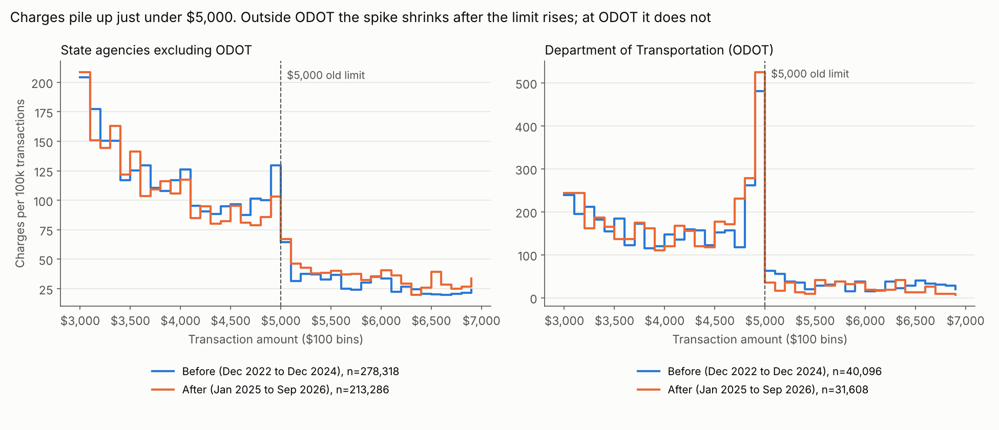
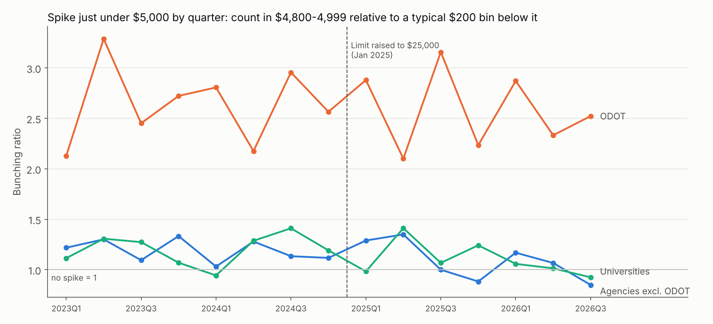
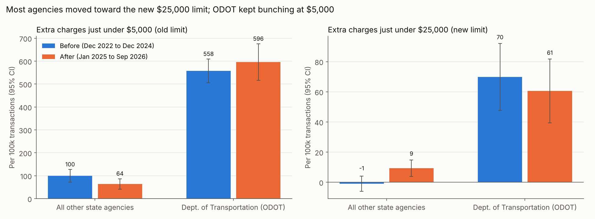

# Do card limits change behavior? Evidence from 1.4 million Oklahoma purchase-card transactions

**Avi Goldberg** · Economics PhD student, UT Austin

Oklahoma publishes every transaction made on its government purchasing cards (P-cards). For years these cards had a $5,000 single-purchase limit. On January 1, 2025 the state raised it to $25,000. I use the public transaction data and the limit change to measure how much spending piles up just under a card limit, whether that pile-up reflects split purchases, and whether it moves when the limit moves.

**Headline results**

- **Spending piles up just under the limit.** Before the change, state agencies made 2.2x the expected number of charges between $4,800 and $4,999: about 500 extra charges (±44), roughly $2.5M, over 25 months. Placebo thresholds at $3k, $4k, $6k and $7k show nothing.
- **Charges near the cap are more often split purchases.** 14.7% of $4,800 to $4,999 charges belong to a cluster of same-cardholder, same-merchant charges within 3 days that adds up to more than $5,000. The rate is 10.3% at $3,800 to $3,999 and 7.7% at $2,800 to $2,999.
- **Most agencies responded to the new limit; the largest agency card program did not.** Outside the Department of Transportation (ODOT), the $5,000 spike fell 36% and a new spike formed just under $25,000 that universities, which run their own card programs, do not show. ODOT, which accounts for two-thirds of the excess, kept bunching at $5,000 exactly as before.

**Takeaway for spend management:** the limit people respond to is the one set on each card, not the one in the policy document. Bunching in transaction data shows which spending controls actually bind, with no labeled fraud cases needed.

---

## 1. What I was trying to learn

Corporate cards rely on spending limits. A limit that binds has two costs: legitimate purchases above it are delayed, and some employees get around it by splitting one purchase into several charges. Both are hard to see directly, since nobody labels a charge "split to dodge the limit."

I asked three questions:

1. How much spending bunches just under the limit?
2. Is the bunching explained by split purchases?
3. When the limit rises, does the bunching move with it? If the limit is what causes the pile-up, it should leave $5,000 and reappear under $25,000.

## 2. Data

- **Source:** Oklahoma Office of Management and Enterprise Services, monthly P-card files on [data.ok.gov](https://data.ok.gov) ("Purchase Card (PCard) Fiscal Year ..." datasets).
- **Coverage:** Dec 2022 to Sep 2026 (May 2025 and Jan 2026 not available). 1,406,839 transactions from 9,543 cardholders at 120 agencies and institutions; 563,308 of them at state agencies.
- **Fields:** agency, cardholder last name and first initial, merchant, merchant category (MCC), amount, transaction and posting dates.

**The raw files needed auditing** (`results/data_audit.csv`):

- Some file names do not match their contents. `pcard_public_202505.csv` contains April 2025, and one `pcard_public_202606` file contains May 2026. I assign each row to a month from its posting date rather than trusting the file name.
- Four files were exact duplicates; I drop them, then drop duplicate transactions.
- The portal also hosts a second report format (`county-p-card-spend`) that looks like the same data but covers only counties and a handful of programs. Mixing it in produced a spurious 43% "drop" in split purchases in an early draft. Only the consistent statewide format is used.

## 3. Approach, and why

**Why not a classifier?** There are no labels: no charge is marked as a split purchase. A supervised model would have nothing to learn from, and an unsupervised anomaly score could not be checked. A bunching design answers the question directly from the distribution of amounts.

**Bunching estimator.** I count charges in $50 bins from $2,500 to $8,000, fit a 7th-degree polynomial to the counts excluding the $200 just under the threshold, and add dummies for round-number pricing ($100, $500 and $1,000 multiples). The fitted curve gives the counterfactual number of charges just under the limit; the excess is actual minus counterfactual. Standard errors come from a residual bootstrap (500 draws). This is the standard method for measuring bunching at tax thresholds (Saez 2010; Chetty et al. 2011; Kleven 2016). The same estimator, with $500 bins, measures bunching at $25,000.

**Natural experiment.** The January 2025 limit increase changes where the limit is without changing what agencies buy. If the limit causes the bunching, the excess at $5,000 should shrink and an excess at $25,000 should appear. Universities and colleges operate their own card programs and serve as a comparison group.

**Split-purchase detection.** A rule, not a model, so every flag is explainable: same cardholder and merchant, 2 to 4 charges within 3 days, each under $5,000, the largest at least $2,000, adding up to $5,000 to $15,000, excluding merchant categories where the cap does not apply (utilities, telecom, interagency).

## 4. Results

### Spending piles up just under $5,000



| State agencies, before the change | Excess charges per 100k transactions (SE) |
|---|---|
| **$5,000 (actual limit)** | **157 (14)** |
| $3,000 (placebo) | −13 (19) |
| $4,000 (placebo) | 9 (23) |
| $6,000 (placebo) | 13 (19) |
| $7,000 (placebo) | 15 (16) |

Charges near the limit are more often part of a split cluster: 14.7% (±1.2) at $4,800 to $4,999, compared with 10.3% (±1.1) at $3,800 to $3,999 and 7.7% (±0.8) at $2,800 to $2,999.

### When the limit rose, most agencies moved; ODOT did not





| Excess charges per 100k transactions | Before | After | Change (SE) |
|---|---|---|---|
| **Agencies excl. ODOT, at $5,000** | 100 | 64 | −36 (18) |
| **Agencies excl. ODOT, at $25,000** | −1 | 9 | **+10 (4)** |
| Universities, at $5,000 | 60 | 44 | −16 (14) |
| Universities, at $25,000 | 0.6 | 0.7 | 0 (1) |
| ODOT, at $5,000 | 558 | 596 | +38 (48) |

- **The cleanest evidence is the new spike at $25,000.** It appears for agencies outside ODOT and not for universities: a difference of +10.2 per 100k (SE 3.9, z = 2.6).
- **The drop at $5,000 is suggestive.** It is significant for agencies outside ODOT (z = −2.0), but universities' spike also drifted down, so the difference between the two (−20, SE 23) is not significant on its own.
- **ODOT is the exception.** Its spike is 4x the expected level, accounts for 66% of the excess before the change and 87% after, and did not move. Its near-cap charges come from fleet and industrial suppliers (BG Products, Hall Manufacturing, NAPA, Grainger, Fastenal). Agencies set each card's own single-purchase limit, and past state audits of ODOT found invoices paid in pieces to stay under that limit. The likely explanation is that ODOT's cards stayed at $5,000 after the statewide ceiling rose.

## 5. How I validated it

- **Placebo thresholds.** Excess at $3k, $4k, $6k and $7k is small and not significant; the $5,000 excess is 11 standard errors from zero.
- **Comparison group.** Universities, which run their own card programs, show no new spike at $25,000.
- **Timing.** Quarterly estimates show the $5,000 spike was stable for the two years before January 2025, so the later decline is not the continuation of an earlier trend.
- **Data audit.** Mislabeled files, duplicates and a look-alike report format were found and handled; the early spurious result from that format is documented above.
- **A test that did not work, reported anyway.** I identified 165 cardholders whose own limits were demonstrably raised (no non-exempt charge above $5,000 before, at least one after) and compared them with 653 who never went above $5,000. Their near-cap rate fell by 10 per 10k transactions relative to the comparison group (95% CI −28 to +6): not significant. They still bunch under $5,000 after the change (ratio 1.39, z = 2.9), consistent with habit or internal approval rules outliving the card limit.
- **Exploratory vs planned.** The ODOT split was found by looking at the data, not planned in advance. I treat it as a mechanism finding. The confirming test is ODOT's card-level limit settings, which OMES could provide.

## 6. Why this matters for spend management

A company can change a limit in software in seconds. This project shows the change does not reliably change behavior: one department ignored a fivefold increase, and some cardholders whose limits did rise kept stopping at the old line. Bunching gives a label-free way to:

- measure whether a control binds, and how much spend sits just under it;
- tell when a policy change has actually reached cards and employees;
- prioritize audits toward the cards, merchants and departments where the pile-up is concentrated.

## 7. Limitations and next steps

- I do not observe each card's limit, so "treatment" is inferred. Card-level limits from OMES would turn this into a direct test.
- Bunching measures where charges land, not intent. Some near-cap charges are legitimate purchases priced to fit.
- Two months are missing, and the post-period is 21 months; the $25,000 spike is based on a few dozen charges.
- Next: estimate an agency-level event study as card settings change, and link P-card charges to the state's vendor-payment data to see whether purchases just above $5,000 moved from purchase orders onto cards.

## Reproduce

```bash
pip install -r requirements.txt
# download pcard_public_*.csv files into data/raw/ (see data/README.md)
./run_all.sh          # load -> analysis -> figures (about 5 minutes)
```

| File | What it does |
|---|---|
| `src/load.py` | Reads all monthly files, fixes labels, de-duplicates, writes `results/data_audit.csv` |
| `src/bunching.py` | Bunching estimator with bootstrap standard errors |
| `src/analysis.py` | Every estimate in this README; writes `results/*.csv` and `results/summary.json` |
| `src/figures.py` | The three figures |

**Policy sources:** [OMES P-card threshold increase notice](https://aem-prod.oklahoma.gov/content/dam/ok/en/omes/documents/P-cardThresholdIncrease.pdf) · [OMES P-card FAQ](https://oklahoma.gov/omes/divisions/central-purchasing/p-card-services/faq.html) · [State Auditor ODOT P-card report, FY2016](https://www.sai.ok.gov/Search%20Reports/database/ODOTP-Card16WebFinal.pdf)

**Method references:** Saez (2010), "Do Taxpayers Bunch at Kink Points?" *AEJ: Economic Policy*. Chetty, Friedman, Olsen and Pistaferri (2011), *QJE*. Kleven (2016), "Bunching," *Annual Review of Economics*.
